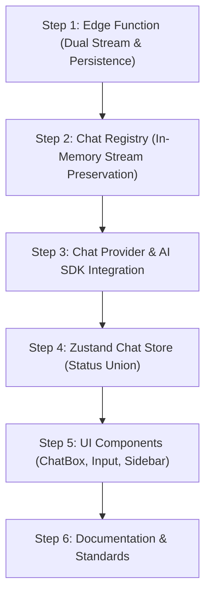

# Changes Report & Understanding Roadmap

This document summarizes the recent architectural and codebase changes across StudyBot, prioritized for review, along with a pedagogical step-by-step roadmap to build a complete mental model of the system.

---

## 📊 1. Full Changes Report

### A. Edge Function & Supabase Backend
* `packages/supabase/functions/chat/index.ts`:
  - **Stream Splitting**: Splits the LLM stream into two parallel writers (Client SSE channel + Server Persistence channel).
  - **Draining & Persistence**: Model outputs drain and save to the DB via `runInBackground` even if the client disconnects or aborts early.
  - **Background Title Generation**: Triggers an async LLM call on the first user message to title the thread.
* `packages/supabase/schemas/public/tables/chat_sessions.sql` & `packages/supabase/migrations/20260825141315_align_chat_sessions_model_default.sql`:
  - Updated default model to `cohere/north-mini-code:free`.
* `packages/supabase/sdk/chat/chat.ts`:
  - Added `fetchThreadTitle(threadId)` for client polling.
* `packages/supabase/scripts/apply-schema.sh`:
  - Aligned schema diff script with declarative `pg-delta` engine (`./schemas/`).

---

### B. Web Chat Architecture & Streaming
* `apps/web/lib/chat/chatRegistry.ts` *(New)*:
  - Per-thread map of long-lived AI SDK `Chat<UIMessage>` instances.
  - Keeps streams consuming in the background when users switch threads.
  - Dynamic bearer token resolution for fresh JWTs.
* `apps/web/types/chatRegistry.types.ts` *(New)*:
  - Extracted `ChatRegistryCallbacks`, `ChatRegistryConfig`, and `ChatFinishInfo`.
* `apps/web/app/providers/ChatProvider.tsx`:
  - Wires `chatRegistry` with lifecycle callbacks.
  - Implements `pollGeneratedTitle()` with sidebar loading indicators.
  - Prevents race conditions during thread switching and message fetching.
* `apps/web/components/chat/ChatBox.tsx` & `apps/web/components/chat/AssistantMessages.tsx`:
  - Added `TypingDots` bubble while awaiting initial response token.
* `apps/web/components/chat/Input.tsx`:
  - Lazy thread creation starts with `"New Chat"`, allowing the server edge function to title it asynchronously.

---

### C. State Management & Sidebar / Navbar
* `apps/web/types/chatStore.types.ts`:
  - Introduced `ChatStoreStatus = "idle" | "loading" | "error"`.
  - Removed dead `messages` / `setMessages` (now managed by AI SDK).
* `apps/web/stores/chatStore.ts`:
  - Updated store state to 1:1 match `ChatStoreState`.
  - Added `titleGeneratingThreadId` state tracking.
* `apps/web/hooks/chat/useChatSessions.ts`:
  - Replaced boolean flags with `setStatus("loading" | "idle" | "error")`.
* `apps/web/components/global/Sidebar.tsx`:
  - Replaced `useState` + `useEffect` hydration with `useSyncExternalStore` (zero cascading renders).
  - Replaced `` with Next.js `<Image />` (`priority`, WebP/AVIF).
  - Shows animated blur placeholder while thread title is generating.
* `apps/web/utils/sidebar.utils.ts` *(New)*:
  - Extracted storage subscription, snapshot getters, and clamping logic.

---

### D. Security & Documentation
* `.agents/security/security-issues.md` *(New directory)* & `.gitignore`:
  - Moved security issues report to an ignored `.agents/security/` folder.
* `.agents/AGENTS.md`, `README.md`, `apps/web/README.md`, `packages/README.md`:
  - Documented the long-lived chat registry, status union, pgdelta declarative DB workflow, and edge function resilience pattern.

---

## 🚨 2. Review List (Sorted by Criticality & Risk)

| Priority | Component / File | Why It Requires Review |
| :--- | :--- | :--- |
| **P0 (Critical)** | `packages/supabase/functions/chat/index.ts` | Edge function stream pump, dual-channel reader/writer splitting, and DB persistence via `runInBackground`. |
| **P1 (High)** | `apps/web/lib/chat/chatRegistry.ts` | Core in-memory state machine for active SSE streams across thread switching and token refreshes. |
| **P1 (High)** | `apps/web/app/providers/ChatProvider.tsx` | Title polling, stream lifecycle hooks, and optimistic send routing. |
| **P2 (Medium)** | `apps/web/types/chatStore.types.ts` & `apps/web/stores/chatStore.ts` | Status union (`ChatStoreStatus`), removal of dead message state, and store cleanup. |
| **P2 (Medium)** | `apps/web/utils/sidebar.utils.ts` & `apps/web/components/global/Sidebar.tsx` | `useSyncExternalStore` hydration fix, clamping logic, and Next.js `<Image />` replacement. |
| **P3 (Low)** | `.agents/AGENTS.md` & `.gitignore` | Project documentation and untracked security folder setup. |

---

## 🗺️ 3. Step-by-Step Understanding Roadmap

To build a clean mental model, review the changes **from the data source (backend) up to the user interface (frontend)**:

---

### Step 1: Understand the Server-Side Stream Pipeline
> **Goal**: See how the server streams tokens to the client while simultaneously saving them to Postgres.
1. Open `packages/supabase/functions/chat/index.ts`.
2. Look at how `clientChannel` and `persistChannel` are created from a single LLM stream pump.
3. Check `runInBackground(...)` and title generation on the first user exchange.
4. Check `packages/supabase/sdk/chat/chat.ts` for `fetchThreadTitle`.

---

### Step 2: Understand the Client In-Memory Stream Registry
> **Goal**: See how the client continues receiving SSE streams when a user clicks another thread in the sidebar.
1. Open `apps/web/types/chatRegistry.types.ts` to see the callback and config contracts.
2. Open `apps/web/lib/chat/chatRegistry.ts` to see `getOrCreateChat()` and the `chats = new Map<string, Chat<UIMessage>>()` cache.

---

### Step 3: Understand State Synchronization & Title Polling
> **Goal**: Connect the registry and server title generation with React Context.
1. Open `apps/web/app/providers/ChatProvider.tsx`.
2. Notice `pollGeneratedTitle`: how it polls the DB for the server-generated title and updates the store.
3. Notice `sendMessageWithThread`: routes user messages to the specific thread instance in `chatRegistry`.

---

### Step 4: Understand Store Refactoring & Status Union
> **Goal**: Understand why dead message state was removed and how status transitions work.
1. Open `apps/web/types/chatStore.types.ts` to see `ChatStoreStatus = "idle" | "loading" | "error"`.
2. Open `apps/web/stores/chatStore.ts` to see the state selector shape.
3. Open `apps/web/hooks/chat/useChatSessions.ts` to see how thread operations use `setStatus()`.

---

### Step 5: Understand UI Polish & Modern React Patterns
> **Goal**: See how UI state renders and how `localStorage` is synced without cascading renders.
1. Open `apps/web/components/chat/ChatBox.tsx` & `apps/web/components/chat/AssistantMessages.tsx` for the typing dots indicator.
2. Open `apps/web/utils/sidebar.utils.ts` for `useSyncExternalStore` helpers and clamping logic.
3. Open `apps/web/components/global/Sidebar.tsx` to see the clean external store hook and `<Image />` component.

---

### Step 6: Review Architecture Documentation
> **Goal**: Verify that repo guidelines match the current codebase.
1. Open `.agents/AGENTS.md` to review the streaming and SDK sections.

